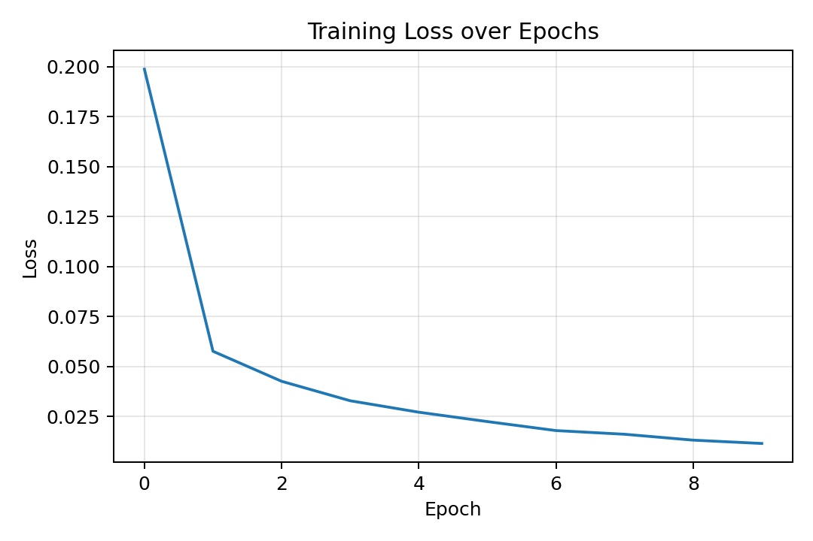
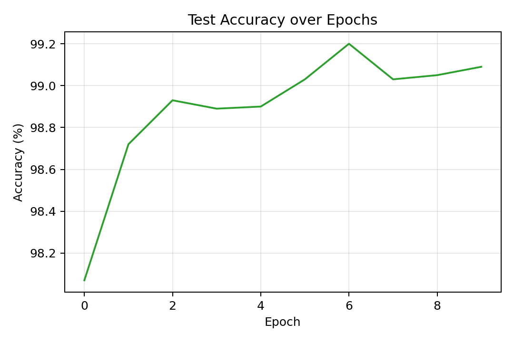
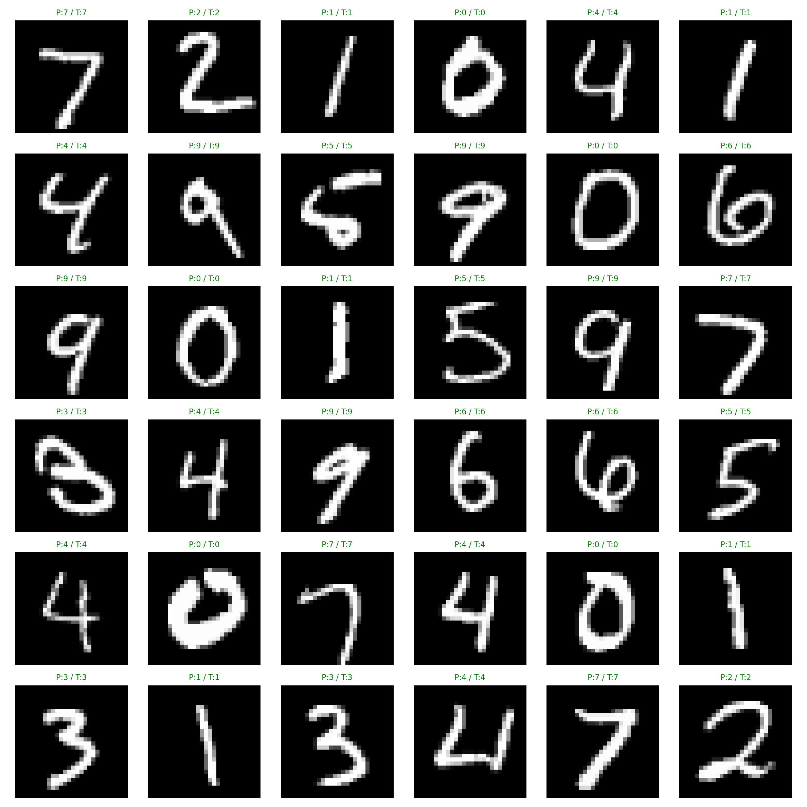
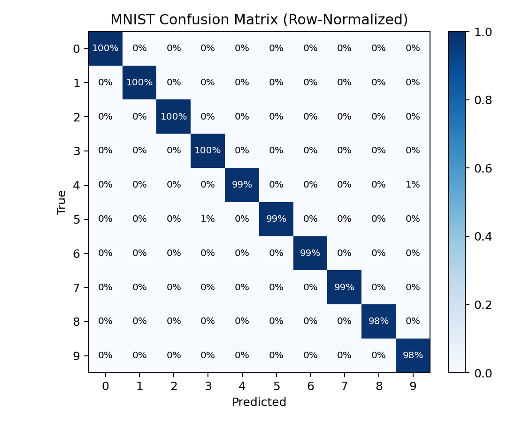
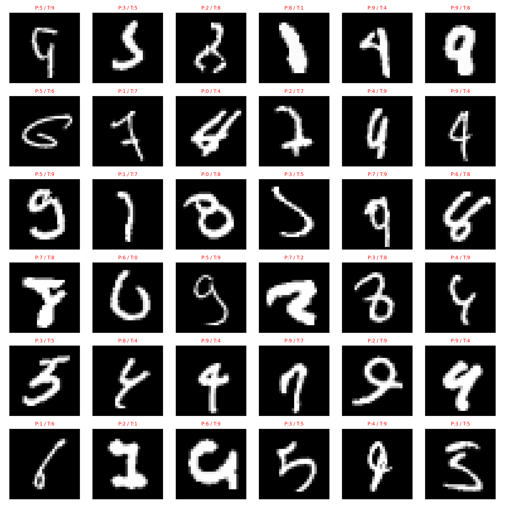

# 实验一：MNIST 手写数字识别实验报告

## 概述

本实验旨在构建一个轻量且可复现的卷积神经网络，用于 MNIST 手写数字的自动识别。我们采用两层卷积与池化的经典结构，在仅使用基础预处理（ToTensor）的前提下，通过交叉熵损失与 Adam 优化器完成从训练到评估的完整流程。训练过程的关键指标被写入 TensorBoard，并在验证准确率达到新高时自动保存最佳权重到 `models/best_mnist_cnn.pth`，以保证结果可以稳定复现。

## 解决方案

### 网络结构设计

在网络设计上，我们以 1×28×28 的灰度输入为起点，先后使用 5×5 的卷积核提取边缘与纹理等低中级特征，卷积之后接 ReLU 激活以增强非线性表达能力，并在每个卷积块之后使用 2×2 的最大池化将空间尺寸从 28×28 降到 14×14，再从 14×14 降到 7×7，从而在保持主要判别信息的同时有效抑制噪声并降低参数规模。特征经展平后进入一个线性层直接输出 10 维的类别得分；这样的设计仅需约三万级别的参数量，能在 CPU 与主流 GPU 上快速完成训练。

### 损失函数与优化器

训练过程中，我们以交叉熵作为优化目标函数，原因在于该损失能与最终的分类准确率直接关联；优化器选择 Adam，默认学习率 1e-3，以便在无需复杂调参的情况下获得稳定收敛。训练脚本会在每个 epoch 结束后对测试集进行评估，并将训练损失与测试准确率分别记录为 `Loss/train` 与 `Accuracy/test`，便于后续可视化与对比分析；一旦出现新的最佳准确率，模型参数会被即时持久化保存，避免“最后一轮并非最优”的问题。

## 实验分析

### 数据集介绍

MNIST 数据集包含 70,000 张 28×28 的灰度手写数字图像，其中训练集 60,000 张、测试集 10,000 张。本文使用 `torchvision.datasets.MNIST` 自动下载并按官方划分进行训练与评估；除 ToTensor 外不做额外预处理，作为对比的纯基线设置。

### 实验结果与分析

为了直观展示训练过程与模型性能，我们从 TensorBoard 事件文件中导出了训练曲线。下图展示了随训练推进的损失变化趋势，可以看到曲线整体单调下降并趋于平稳，这表明模型逐步学会了稳定的判别特征。

相应地，测试集上的分类准确率也随训练轮次上升并在后期收敛。对于 MNIST 这样规模适中的标准数据集，这类轻量 CNN 在 10 个 epoch 左右通常即可达到 98% 以上的准确率；具体数值以你本地运行的曲线与控制台日志为准。

为了更细致地理解模型在样本级别的表现，我们还随机选取了测试集中的若干图像并给出模型预测与真实标签的对照。绿色标题表示预测正确，红色表示预测错误。从可视化可以看出，大多数清晰书写的数字都能被准确识别，而某些形似类别（如 4/9、3/5、5/6）在笔迹模糊、连笔或者旋转较大时更容易出现误判，这与人类视觉的主观体验是一致的。

### 实现与核心代码位置

关于实现细节，训练脚本 `train_mnist.py` 使用 argparse 统一管理数据路径、训练轮次、批大小与学习率等参数；数据通过 `torchvision.datasets.MNIST` 自动下载与缓存；设备选择会根据是否可用的 CUDA 自动切换到 GPU，以获得更快的训练速度；同时，脚本会使用一个虚拟输入将模型计算图写入 TensorBoard，便于检查网络结构是否符合预期。这样的工程化设计让训练、复现实验与对比改进都变得简单可靠。核心训练与评估逻辑可在 `train_mnist.py` 与 `eval_mnist.py` 中查看；相应的可视化导出脚本位于 `tools/` 目录。

### 创新点（或改进方向）

从实验结果上看，仅依赖基本预处理，模型即可在较短时间内收敛到较高的测试准确率；如果进一步加入输入归一化（以 MNIST 的经验均值与方差进行标准化）、在卷积后添加 BatchNorm、使用轻度的数据增强（如随机旋转、平移）以及学习率调度（例如 StepLR 或 CosineAnnealingLR），通常还能在稳定性的前提下获得 0.2%～0.6% 左右的性能提升。对于易混淆的类别对，引入更深的特征表达、正则化策略（Dropout、Weight Decay、Label Smoothing）或者在训练后期进行知识蒸馏与集成平均，都是可探索的方向。

### 混淆矩阵

为了更全面地刻画误差分布，我们还绘制了基于测试集的行归一化混淆矩阵。可以观察到对角线元素整体接近 100%，而极少数非对角线位置体现了形似类别之间的混淆关系，例如 4/9、3/5、5/6 等对，这些位置的亮度提示了改进空间。对于这类错误，引入轻量数据增强与正则化通常能带来稳定收益，必要时也可以尝试更深的特征表达或蒸馏迁移学习。

### 易错样本

为了直观呈现模型的不足，我们还额外汇总了若干“易错样本”，即模型在测试集上预测错误的案例，使用 6×6 的九宫格展示预测值与真实值的对照。这些样本往往具有笔迹不清晰、连笔或形变较大的特点，展示了当前模型在复杂书写风格下的潜在改进空间。

### 资源与开销

为了便于横向对比与资源预算，我们以表格的形式补充了模型体量与资源开销的关键信息（参数量为静态计算，文件大小基于当前最优权重文件）。

| 指标 | 数值 | 说明 |
| --- | ---: | --- |
| 参数总量（约） | 28,938 | 两层 5×5 卷积 + 1 全连接（32×7×7→10） |
| 模型文件大小 | 115.83 KB | 基于实际权重文件统计 |
| 训练轮数 | 10（可调） | `--epochs` 参数控制 |
| 批次大小 | 64（可调） | `--batch-size` 参数控制 |
| 学习率 | 1e-3（可调） | `--lr` 参数控制 |
| 训练/评估设备 | GPU/CPU 自动 | `--no-cuda` 可强制 CPU |

## 总结

综上，本实验以一个结构简洁的 CNN 为基础，打通了数据准备、模型训练、指标记录、结果可视化与最佳权重保存的完整链路，能够在标准的 MNIST 数据集上获得可靠的识别效果。若将来需要用于教学演示或作为更复杂模型的起点，这份实现提供了清晰的脚手架：参数一处配置即可复现，日志与图像可直接对照分析，模型文件可随时加载评估与部署。你可以直接使用仓库中提供的小工具脚本从现有日志导出图像（位于 `tools/` 目录）；若本地尚未生成图片，可先完成一次训练，随后运行脚本即可自动在 `figures/` 目录下生成相应的曲线图与样例可视化。

