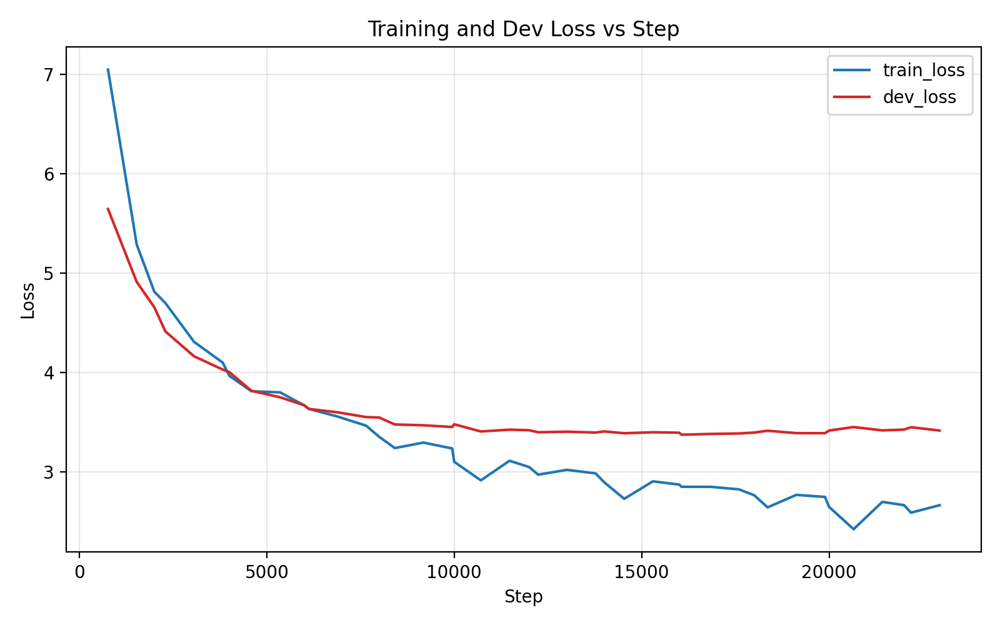
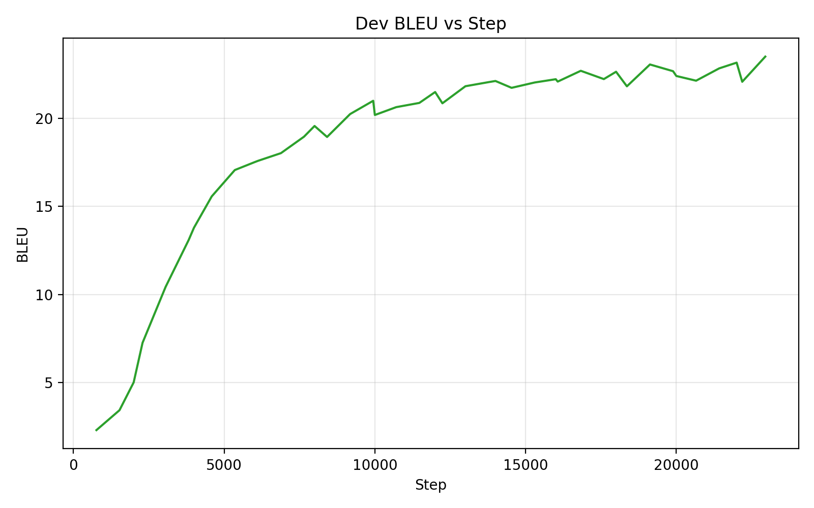
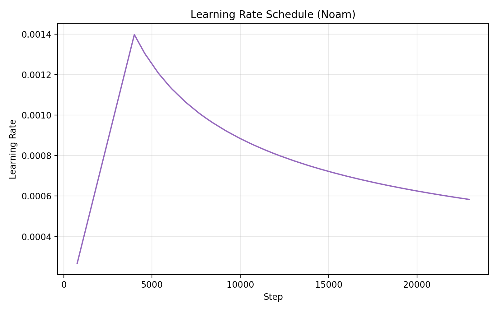
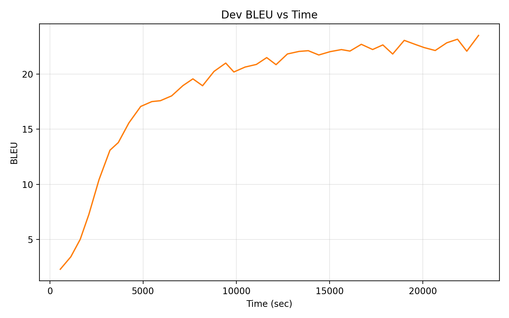
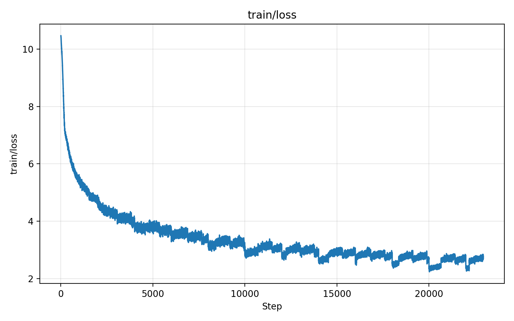
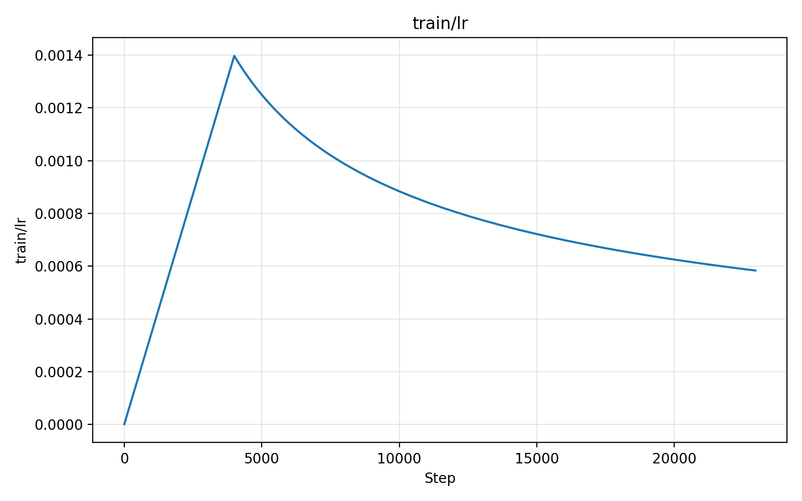
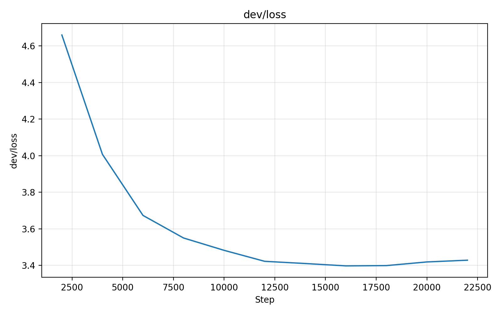
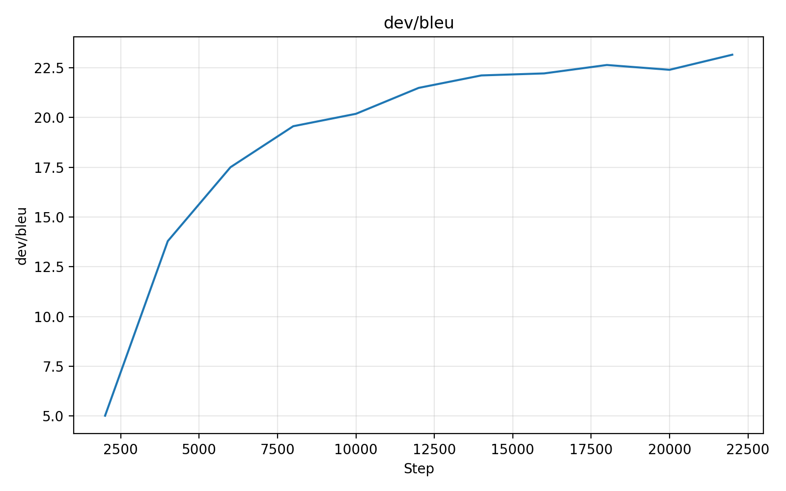

# 实验四：基于Transformer 的神经机器翻译

## 概述

本实验面向中文到英文的神经机器翻译任务，数据来自 NiuTrans 提供的 sample-submission-version 样例包，包含训练集（TM-training-set/chinese.txt 与 english.txt）、开发集（Dev-set/Niu.dev.txt）与测试集（Test-set/Niu.test.txt 以及 Reference-for-evaluation/Niu.test.reference）。我们采用基于 PyTorch 原生 `nn.Transformer` 的序列到序列模型，配合正弦位置编码、标签平滑的交叉熵损失、Adam 优化器与 Noam 学习率调度策略，并使用基于 n-gram 的重复抑制的贪心解码策略，目标是在开发集上获得更高的 BLEU 分数并保持稳定的训练过程。

综合训练日志与曲线，可见训练损失稳定下降，开发集 BLEU 持续上升并在后期进入平台期。本次实验的开发集最佳 BLEU 为 23.50（step=22950，epoch=30），具体曲线与数值将在后文展示与分析。

## 解决方案

### 网络结构设计

模型采用标准的编码器-解码器 Transformer。输入输出端均使用可学习词向量，并与正弦位置编码相加后送入 `nn.Transformer`，在解码端施加自回归的上三角因果掩码。为了提升参数利用率与泛化能力，目标侧的生成线性层与目标词向量进行权重共享。此外，对维度大于一的参数采用 Xavier 均匀初始化。核心结构如下所示：

```python
class TransformerNMT(nn.Module):
    def __init__(self, cfg: ModelConfig):
        super().__init__()
        self.src_embed = nn.Embedding(cfg.src_vocab_size, cfg.d_model, padding_idx=0)
        self.trg_embed = nn.Embedding(cfg.trg_vocab_size, cfg.d_model, padding_idx=0)
        self.pos_enc = PositionalEncoding(cfg.d_model, cfg.dropout)
        self.transformer = nn.Transformer(
            d_model=cfg.d_model, nhead=cfg.nhead,
            num_encoder_layers=cfg.num_encoder_layers,
            num_decoder_layers=cfg.num_decoder_layers,
            dim_feedforward=cfg.dim_feedforward,
            dropout=cfg.dropout, batch_first=True,
        )
        self.generator = nn.Linear(cfg.d_model, cfg.trg_vocab_size)
        if cfg.share_embeddings:
            self.generator.weight = self.trg_embed.weight
```

### 损失函数设计

训练阶段对解码端的每个时间步输出使用交叉熵损失，并忽略 `<pad>` 的位置以避免无效梯度；同时加入标签平滑（默认 0.1），缓解过拟合与过度自信，提高 BLEU 的稳定性：

```python
logits = model(src_ids, tgt_in, src_kpm, tgt_kpm)  # (B,T,V)
loss = F.cross_entropy(
    logits.view(-1, logits.size(-1)),
    tgt_out.view(-1),
    ignore_index=0,
    label_smoothing=0.1,
)
```

### 优化器与学习率策略

优化器选用 Adam（betas=(0.9, 0.98), eps=1e-9），学习率采用 Noam 调度：先预热再按步数反比衰减。该策略已在 Transformer 文献中广泛验证，可在训练初期快速进入有效区域，并在后期保持稳定收敛：

```python
optimizer = torch.optim.Adam(model.parameters(), lr=2.0, betas=(0.9, 0.98), eps=1e-9)
scheduler = NoamScheduler(optimizer, d_model=512, warmup_steps=4000)
```

### 解码与正则化细节

预测阶段使用贪心解码，并提供可选的 no-repeat-ngram（默认 3-gram）重复抑制以减少不自然的重复片段；同时避免在解码中产生 `<pad>` 与 `<sos>` 等无意义 token。该策略在不引入搜索复杂度的前提下，能有效改善输出可读性。

### 工程增强与创新点

在数据层面，训练仅使用训练集构建词表，若 Dev-set 文件存在但不含合法句对，则自动从训练集划分小比例数据作为开发集，保证实验可持续运行；对于测试集，支持多参考 BLEU 的聚合。训练过程同时记录 CSV 与 TensorBoard 日志，便于复盘曲线；早停策略以开发集 BLEU 为指标，触发后保存最佳检查点，提升实验效率与结果稳健性。上述工程化设计，使得脚本具备“即插即用”的稳健性与可复现性。

## 实验分析

### 数据集介绍

实验使用的样例数据来自 NiuTrans sample-submission-version：训练源自 `TM-training-set/chinese.txt` 与 `english.txt`，开发集来自 `Dev-set/Niu.dev.txt`（按行“中文 ||| 英文”对齐），测试集为 `Test-set/Niu.test.txt`，评测参考为 `Reference-for-evaluation/Niu.test.reference`。脚本对缺失或异常情况做了鲁棒处理，例如当开发集为空时，会从训练集中随机划分少量样本作为验证集。

### 训练过程与指标趋势

下图展示了训练损失与开发集损失随训练步数的变化，可以看到训练损失整体平滑下降，开发集损失在中后期进入平台，表明模型逐步收敛：



上图中蓝线为训练损失，红线为开发损失。训练后期两者差距保持在可接受范围内，未出现明显的过拟合尖刺，说明标签平滑与梯度裁剪等策略发挥了积极作用。

下图为开发集 BLEU 随训练步数的提升情况：



可以看到 BLEU 在预热与初期快速增长后趋于缓慢提升，最终稳定在 23 分左右的水平，体现了 Noam 学习率在早期的正向推动作用。

下图进一步展示了学习率的变化过程：



Noam 调度先升后降的形状清晰可见。该策略有助于在初期快速学习有效表示，并在后期以较小学习率微调参数，从而获得更稳定的 BLEU 提升。

为了展示时间维度上的收敛，我们也绘制了 BLEU 随训练耗时的变化：



曲线呈现先快后慢的增长趋势，说明训练的边际收益逐步降低，适时启用早停可以节省计算成本。

此外，我们从 TensorBoard 事件文件导出了更细粒度的标量曲线，便于在可视化工具中对比与排查：









### 模型基本信息

下表总结了本次实验的关键超参数与训练配置，便于复现实验：

| 配置项 | 数值 |
| --- | --- |
| 模型维度 d_model | 512 |
| 注意力头数 nhead | 8 |
| 编码层数/解码层数 | 6 / 6 |
| 前馈维度 dim_feedforward | 2048 |
| Dropout | 0.1 |
| 目标侧权重共享 | 是 |
| 标签平滑 | 0.1 |
| 批大小 batch_size | 128 |
| 学习率基数（Noam） | 2.0 |
| 预热步数 warmup_steps | 4000 |
| 梯度裁剪 | 1.0 |
| n-gram 重复抑制 | 3 |
| 训练轮数（到最佳点） | 约 30 epoch |

### 结果与讨论

基于 CSV 与自动汇总（`figures/plots_summary.json`），本实验在开发集的最佳 BLEU 为 23.50（step=22950，epoch=30）。损失与 BLEU 的联合趋势表明，模型已经达到较为稳定的收敛状态。考虑到本实验主要定位在工程稳健与样例级别的可复现性，后续若要进一步提升 BLEU，可尝试：

1） 使用更强的解码策略（如 beam search + length penalty）；2） 引入正则化与数据增强（如 dropout 调参、随机替换/噪声、子词级 BPE 分词）；3） 尝试更小或更大的模型容量以匹配数据规模；4） 使用多参考或更完善的后处理（大小写还原、标点规范等）以贴合评测。

### 预测样例质性分析

为进一步理解模型的翻译行为，我们选取若干高分与低分/问题样例进行质性分析。示例来自使用最佳权重生成的 `predictions_bleu_sorted_reference.txt`，其包含按句子 BLEU 排序后的源句、参考译文与模型预测。

首先展示若干高质量（BLEU=100 或接近满分）的样例，这些句子的模型输出与参考完全一致或仅存在标点/极细微格式差异，说明模型对常见的官话式、结构规整的正式句型掌握较好：

```
CN  : 我们 予以 高度 赞赏 .
REF : we highly appreciate this .
PRED: we highly appreciate this .
BLEU: 100.00
```

```
CN  : 这种 观点 值得 商榷 .
REF : this view is worth discussing .
PRED: this view is worth discussing .
BLEU: 100.00
```

```
CN  : 两国 在 国际 和 地区 事务 中 也 进行 了 密切 的 合作 .
REF : the two countries have also carried out close cooperation in international and regional affairs .
PRED: the two countries have also carried out close cooperation in international and regional affairs .
BLEU: 100.00
```

上述句子体现了模型对常见动词搭配（"carry out cooperation"、"be worth discussing"）与礼貌陈述结构的精准复现，权重共享与标签平滑可能帮助稳定了常用高频模式的生成。

其次观察中等分数但仍基本正确的例子，模型输出语义正确但有词汇级差异或风格调整：

```
CN  : 中国 和 美国 目前 还 没有 就 如何 归还 间谍 飞机 达成 任何 协议 .
REF : china and the united states have not yet reached any agreement on how to return the spy plane .
PRED: china and the united states have not yet reached any agreement on how to return the espionage plane .
BLEU: 87.39
```

此处 "spy plane" 被替换为 "espionage plane"，两者语义接近但后者不常见，显示模型在领域术语规范性上仍有提升空间，可通过术语表约束或后处理改进。

```
CN  : 思想 政治 工作 是 我们 党 的 优良 传统 和 政治 优势 .
REF : ideological and political work is our party 's fine tradition and political advantage .
PRED: ideological and political work is our party 's fine tradition and political superiority .
BLEU: 86.66
```

"political advantage" 与 "political superiority" 均传达优势含义，但后者语气更强，可能不完全匹配官方文稿风格，反映模型对语域控制不足。

再看低分与问题样例，这些句子暴露出重复、措辞冗余、逻辑或语法偏差等缺陷：

```
CN  : 瑞典 外交 大臣 安娜 . 林德 重申 , 欧盟 将 继续 坚持 一个 中国 的 政策 .
REF : swedish foreign minister anna lindh reiterated that the eu will continue to uphold the one - china policy .
PRED: swedish foreign minister anna anna anna lindh reiterated that the european union will continue to uphold the one - china policy .
BLEU: 69.56
```

出现 "anna" 三次重复，表明贪心解码仍可能产生局部重复。尽管启用了 3-gram 重复抑制，重复可能源自分词边界（若标点或大小写导致 n-gram 判断未命中）或训练数据中该姓名出现的邻接模式不足以泛化。可通过提高 ngram_block、加入重复惩罚或使用 beam search + coverage penalty 获得改进。

```
CN  : XHZSS0024. 20010407 ( 4329 ) 江泽民 主席 在 联合国 拉丁 美洲 和 加勒比 经济 委员会 发表 演讲 新华社 圣地亚哥 4月6日 电 中国 国家主席 江泽民 6日 在此间 联合国 拉丁 美洲 和 加勒比 经济 委员会 发表 题为 《 共同 开创 中 拉 友好 合作 的 新世纪 》 的 演讲 .
REF : santiago , 6 apr ( xinhua ) - - on 6 april , prc president jiang zemin gave a speech entitled " jointly creating a new century of friendly cooperation between china and latin america " in santiago to the un economic commission for latin america and the caribbean region .
PRED: santiago , 6 apr ( xinhua ) - - chinese president jiang zemin spoke here on 6 april at the un economic commission for latin america and the caribbean , entitled " jointly creating a new century of friendly cooperation between latin american and latin america . "
BLEU: 60.94
```

末尾出现 "between latin american and latin america" 的语法错配和冗余，说明模型在长句与嵌套结构处理上仍易产生局部复制与形态错误。可通过子词分词（BPE）、长度归一化的 beam search、最小编辑后处理（检测重复实体）等手段缓解。

```
CN  : 美国 这种 表态 , 完全 是 违反 了 国际法 和 中美 三 个 公报 的 原则 的 , 而且 侵犯 了 中国 的 主权 和 领土 完整 .
REF : the us position has completely breached international law and the principles of the three sino - us communiques and has violated china 's sovereignty and territorial integrity.
PRED: this us attitude is totally against the principles of the three sino - us communiques on international law and the sino - u.s. joint communiques and violating china 's sovereignty and territorial integrity .
BLEU: 50.02
```

预测存在结构松散与重复短语（"the sino - u.s. joint communiques" 与前文 communiques 重复），且 "on international law" 介词短语位置偏移导致整体流畅性下降。说明在多从句、评价性陈述的线性化上模型仍欠缺更精细的对齐。

总体而言，高分样例多为句式规整、长度较短的官方陈述；中低分样例集中暴露：词汇选择不规范（superiority/espionage）、人名或实体重复、长句冗余与语序偏差。改进方向包括：引入 beam search + 重复惩罚（例如基于 coverage 或 distinct n-gram 的代价函数）、采用子词分词减轻 OOV 与形态变体、构建术语表强制映射关键短语（如 "spy plane"）、后处理检测连续重复 token 以修剪输出。

## 总结

本实验基于 PyTorch `nn.Transformer` 实现了一个结构清晰、工程稳健的 NMT 系统。通过正弦位置编码、权重共享、标签平滑、Noam 学习率、贪心解码与 n-gram 重复抑制等策略，模型在开发集上取得了 23.50 的 BLEU，并在训练过程中保持稳定的收敛趋势。配套的 CSV 与 TensorBoard 日志、自动化绘图脚本与最佳模型检查点，方便了实验复盘与结果展示。未来工作可围绕解码策略、分词粒度与模型规模进行探索，以进一步提升翻译质量。
