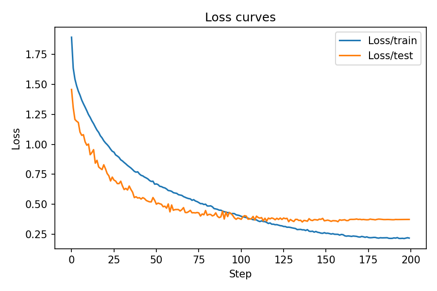
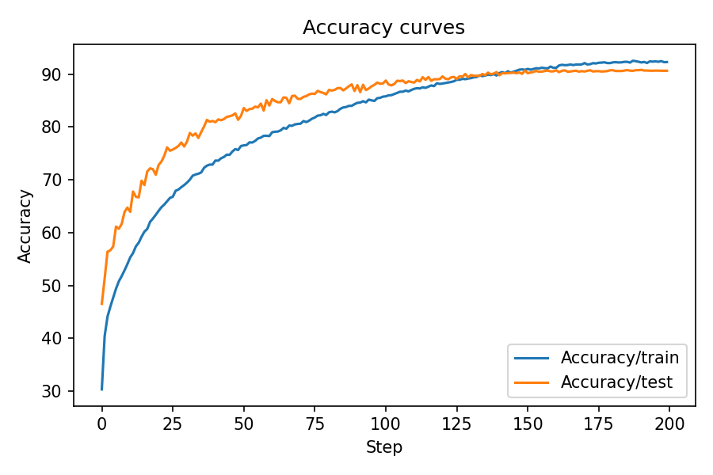
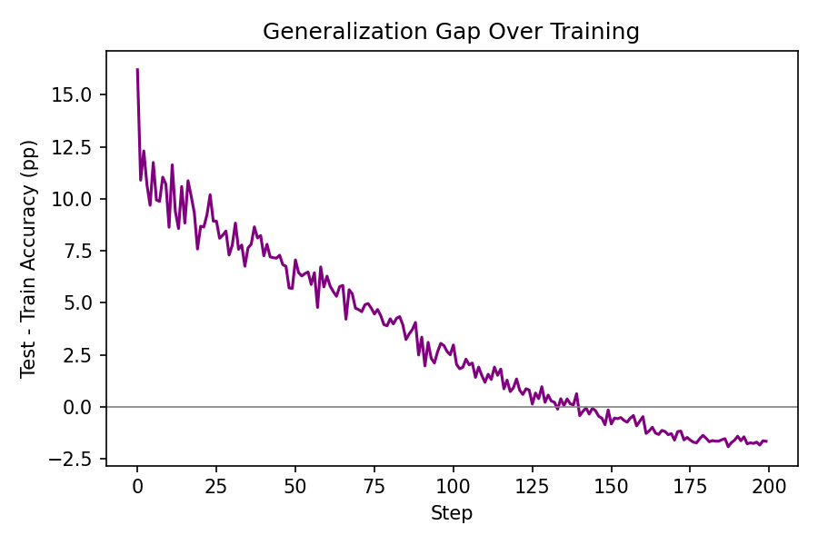
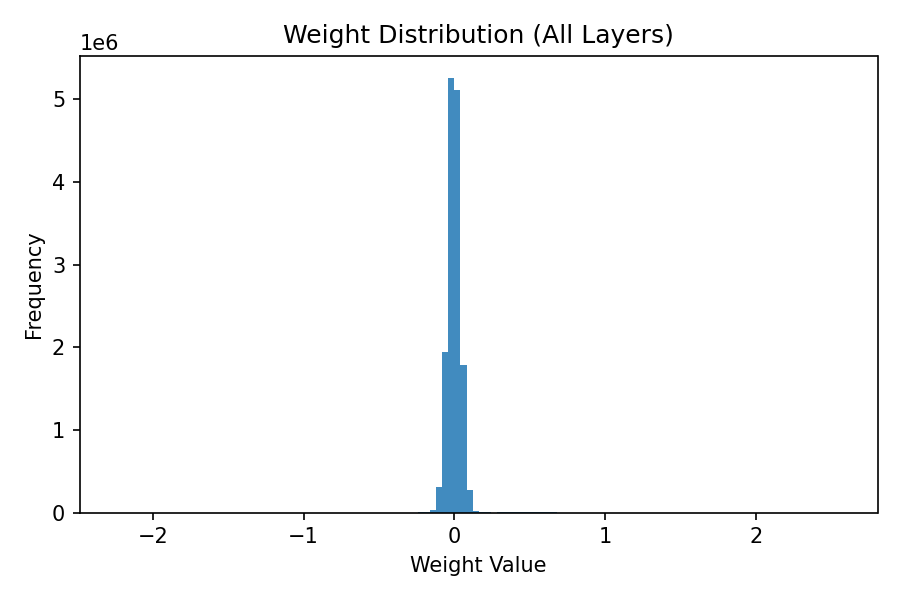
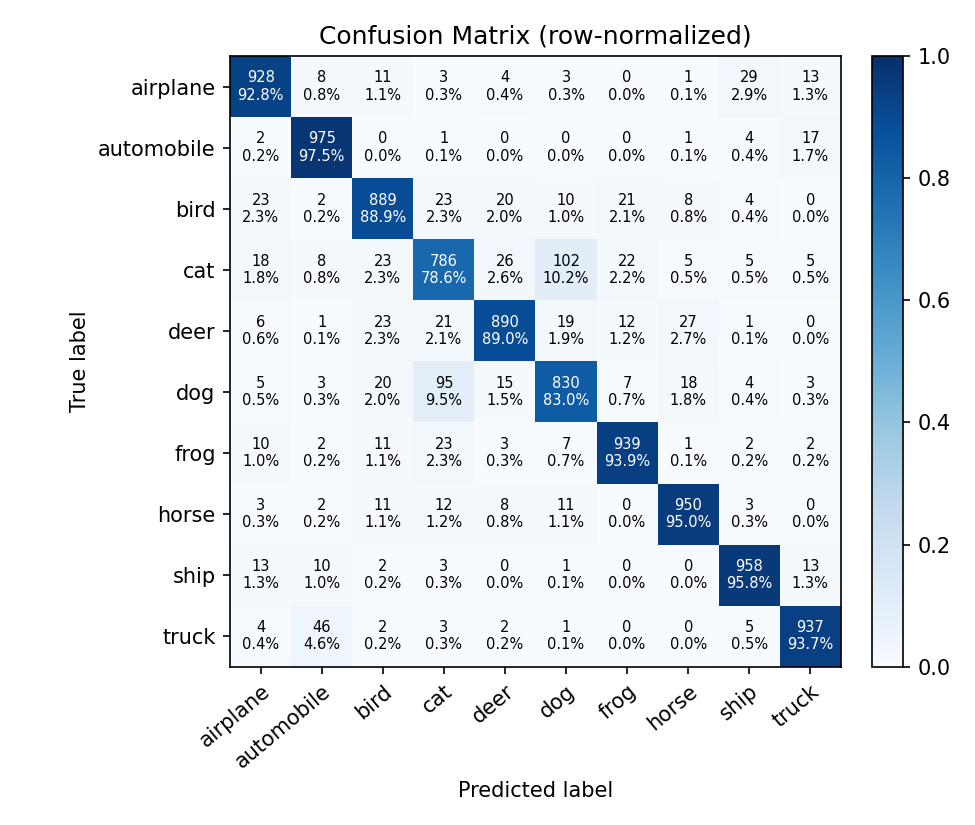
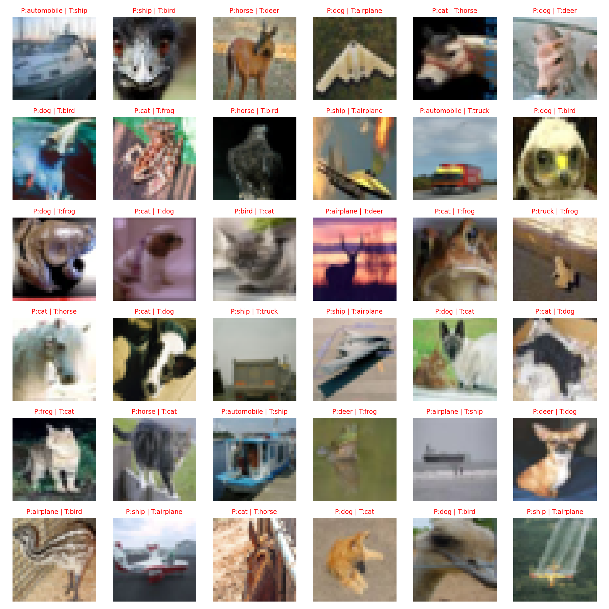

# 实验二：基于 ViT 的 CIFAR10 图像分类

## 概述

本实验针对 CIFAR-10 小尺寸彩色图像分类任务，评估 Vision Transformer (ViT) 在低分辨率数据上的表现。数据集包含 10 个类别、50,000 张训练图像与 10,000 张测试图像，均为 32×32 RGB。相比传统卷积网络，ViT 通过全局自注意力更直接地建模远距离依赖。我们采用分 patch 的图像嵌入、可学习位置编码与分类 token，结合较深的 Transformer 堆叠与正则化策略提升泛化。训练过程中记录损失与准确率曲线，并导出可视化图片用于分析。

## 解决方案

整体流程包括数据增强、图像分块嵌入、Transformer 编码、分类头输出与标准交叉熵优化。输入图像被划分为 4×4 patch，共 (32/4)^2=64 个 patch，加上 1 个 CLS token 组成 65 个序列向量；每个 patch 经线性映射到 512 维嵌入并加 LayerNorm 稳定数值分布。位置编码采用可学习参数。Transformer 深度为 7 层，每层含多头自注意力与前馈网络结构，注意力头数 8，MLP 隐层维度 1024，使用 GELU 激活与 Dropout 0.2 控制过拟合。最终取 CLS token（或均值池化，当前配置为 CLS）输入线性分类头输出 10 类概率。

损失函数采用交叉熵最小化分类误差；优化器为 AdamW (lr=3e-4, weight_decay=0.05)，在 Transformer 中相比传统 Adam 更稳定；学习率调度器使用余弦退火 (CosineAnnealingLR) 平滑降低学习率，有助于在后期细致收敛。数据增强方面除常规随机裁剪与水平翻转外，启用 AutoAugment(CIFAR10 policy) 扩展图像变化空间，协同加权衰减与 Dropout 抑制过拟合。创新点主要体现在：在小尺寸数据上采用较深 ViT 结构并配合多重正则化（LayerNorm + Dropout + AdamW weight decay + AutoAugment），使模型在不显著增加复杂度的情况下获得更高稳定性与泛化表现。

### 网络结构设计（核心代码）
```python
class ViT(nn.Module):
    def __init__(self, *, image_size, patch_size, num_classes, dim, depth, heads, mlp_dim,
                 pool='cls', channels=3, dim_head=64, dropout=0., emb_dropout=0.):
        super().__init__()
        image_height, image_width = pair(image_size)
        patch_height, patch_width = pair(patch_size)
        num_patches = (image_height // patch_height) * (image_width // patch_width)
        patch_dim = channels * patch_height * patch_width
        self.to_patch_embedding = nn.Sequential(
            Rearrange('b c (h p1) (w p2) -> b (h w) (p1 p2 c)', p1=patch_height, p2=patch_width),
            nn.LayerNorm(patch_dim),
            nn.Linear(patch_dim, dim),
            nn.LayerNorm(dim),
        )
        self.pos_embedding = nn.Parameter(torch.randn(1, num_patches + 1, dim))
        self.cls_token = nn.Parameter(torch.randn(1, 1, dim))
        self.dropout = nn.Dropout(emb_dropout)
        self.transformer = Transformer(dim, depth, heads, dim_head, mlp_dim, dropout)
        self.pool = pool
        self.mlp_head = nn.Linear(dim, num_classes)
    def forward(self, img):
        x = self.to_patch_embedding(img)
        b, n, _ = x.shape
        cls_tokens = self.cls_token.expand(b, -1, -1)
        x = torch.cat((cls_tokens, x), dim=1)
        x += self.pos_embedding[:, :(n + 1)]
        x = self.dropout(x)
        x = self.transformer(x)
        x = x.mean(dim=1) if self.pool == 'mean' else x[:, 0]
        return self.mlp_head(x)
```

### 损失函数与优化器设计（核心代码）
```python
criterion = nn.CrossEntropyLoss()
optimizer = optim.AdamW(net.parameters(), lr=args.lr, weight_decay=args.weight_decay)
scheduler = optim.lr_scheduler.CosineAnnealingLR(optimizer, T_max=args.epochs)
```

上述配置中，交叉熵损失直接度量预测分布与真实 one-hot 分布的差异，适用于标准多分类任务；AdamW 在 Transformer 结构中通常比 Adam 更稳定，结合 weight decay 抑制权重无界增长；余弦退火学习率让训练前期快速探索、后期细致收敛，常伴随更平滑的验证曲线与更低的最终损失。

### 训练与验证循环（核心代码）
```python
for epoch in range(start_epoch, args.epochs):
    train(epoch, net, trainloader, optimizer, criterion, device, writer)
    best_acc = test(epoch, net, testloader, criterion, device, writer, best_acc)
    scheduler.step()
```

训练阶段每个 epoch 先在训练集上进行前向/反向传播与优化步骤，再在测试集上评估并记录指标。若测试准确率出现新高，则保存当前权重为“最佳模型”，确保最终复现实验时可直接加载最优结果。学习率在每轮结束后按余弦曲线递减，避免过早进入极小学习率区域导致的欠拟合。

## 实验分析

数据集：使用官方 CIFAR-10 训练集 50,000 张与测试集 10,000 张，按标准均值 (0.4914, 0.4822, 0.4465) 与标准差 (0.2023, 0.1994, 0.2010) 归一化。批大小 128，训练 200 个 epoch。AutoAugment 与随机裁剪、水平翻转联合增强了输入多样性，有助于缓解小数据规模下的过拟合。

训练过程通过 TensorBoard 记录标量，导出损失与准确率曲线如下：





测试集最佳准确率达到 **90.820%**，在未引入更激进正则（如 MixUp/CutMix）与更大模型的情况下取得了较高的基线表现。观察曲线：训练损失与测试损失均呈现稳定下降后平台趋势，准确率曲线在后期波动幅度较小，表明余弦退火与 AdamW 搭配带来平滑收敛。若需继续提升，可尝试：扩大嵌入维度与深度、引入多尺度 patch、加入数据混合增强、延长训练或使用更细致的学习率 warmup 与梯度裁剪。

进一步我们分析了“泛化差距”（测试准确率 − 训练准确率）随训练进程的变化。图中泛化差距从训练早期的较高正值稳步下降，约在第 130–140 步处接近 0，训练后期差值略为负值（测试准确率略低于训练准确率）。总体来看差距收敛到接近 0 的小幅波动，表明当前的数据增强与正则化策略有效抑制了明显过拟合。



同时统计全部浮点权重的分布直方图，用以判断是否存在梯度爆炸/消失导致的极端数值；可以看到权重集中在 0 附近呈现近似对称的分布，没有长尾尖峰，这与 LayerNorm + AdamW 的稳定性策略一致。



### 混淆矩阵与误分类样本

混淆矩阵可以刻画不同类别之间的混淆关系。行归一化的热力图中，对角线元素越接近 100% 说明该类越容易被正确识别；非对角线的亮点提示了易混类别对（例如动物类之间的颜色/纹理相似）。从图中可以看到，大多数类别的对角线占比很高，少数如猫/狗、鹿/马在外观上具备相似纹理与轮廓，容易产生混淆。



误分类样本网格展示了若干模型预测错误的图像，标题中以 P 表示预测类别、T 表示真实类别。红色标题表示预测错误、绿色表示预测正确。可以观察到，背景复杂、姿态变化大或主体被遮挡的图像更容易出现错误；这类样本往往能从更强的数据增强（CutMix/MixUp）、更长训练或更大模型中受益。



## 模型参数

下表统计了按参数数量降序排列的前 10 项，帮助定位计算与存储的主要开销所在（注意多层 Transformer 结构中 qkv 与 MLP 线性层占比最高）。

| 参数名 | 形状 | 数量 |
|---|---:|---:|
| transformer.layers.0.0.to_qkv.weight | 1536x512 | 786,432 |
| transformer.layers.1.0.to_qkv.weight | 1536x512 | 786,432 |
| transformer.layers.2.0.to_qkv.weight | 1536x512 | 786,432 |
| transformer.layers.3.0.to_qkv.weight | 1536x512 | 786,432 |
| transformer.layers.4.0.to_qkv.weight | 1536x512 | 786,432 |
| transformer.layers.5.0.to_qkv.weight | 1536x512 | 786,432 |
| transformer.layers.6.0.to_qkv.weight | 1536x512 | 786,432 |
| transformer.layers.0.1.net.1.weight | 1024x512 | 524,288 |
| transformer.layers.0.1.net.4.weight | 512x1024 | 524,288 |
| transformer.layers.1.1.net.1.weight | 1024x512 | 524,288 |

### 资源与开销

| 指标 | 数值 | 说明 |
| --- | ---: | --- |
| 参数总量（约） | 14,774,890 | ViT 主干 + Patch Embedding + 分类头 |
| 模型文件大小 | 约 56.4 MB | 保存的最佳权重 (`vit_cifar10_optimized-best.pth`) |
| 训练轮数 | 200（可调） | `--epochs` 参数控制 |
| 批次大小 | 128（可调） | `--batch-size` 参数控制 |
| 初始学习率 | 3e-4（可调） | `--lr` 参数控制 + 余弦退火调度 |
| 数据增强 | AutoAugment + 随机裁剪翻转 | 提升多样性与泛化能力 |
| 优化/正则 | AdamW + Weight Decay 0.05 | 抑制过拟合与权重漂移 |
| Dropout | 0.2 / 0.2 (emb) | Transformer 层与嵌入阶段 |
| 设备 | GPU/CPU 自动检测 | CUDA 可用则使用 GPU |
| 最佳测试准确率 | 90.82% | 从 checkpoint 元信息读取 |

## 总结

本实验在 CIFAR-10 上验证了中等规模 Vision Transformer 的有效性。通过较深的多头自注意力与前馈层堆叠、AdamW 优化与余弦退火调度、AutoAugment 强数据增强及合理正则化，模型取得 90.82% 的测试准确率。后续提升方向包括：加入 MixUp/CutMix、梯度累积与更长训练、引入学习率 warmup、探索多尺度或重叠 patch、应用知识蒸馏或更精细的正则策略。整体结果展示了在资源可控条件下 ViT 对小尺寸图像分类的竞争力，为进一步扩展提供了坚实基线。