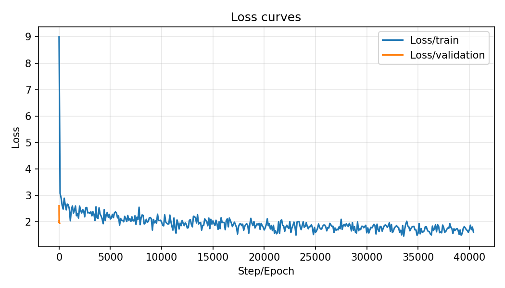
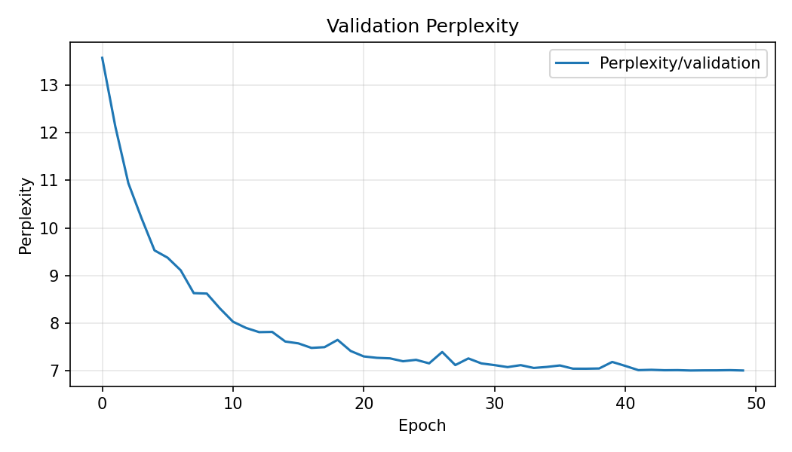
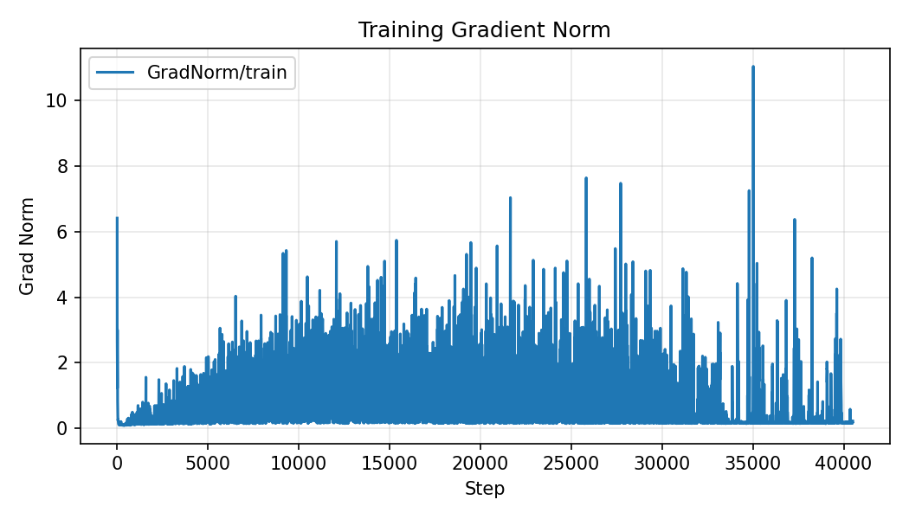

# 实验三：自动写诗（LSTM 语言模型）

## 概述

本实验旨在基于唐诗语料训练自回归语言模型，实现给定起始字词自动续写诗句的能力。数据集使用 `tang.npz`，包含索引化的诗歌序列 `data` 以及 `word2ix`/`ix2word` 词表映射；项目采用 PyTorch 实现，训练过程记录至 TensorBoard。解决方案选用嵌入层与 LSTM 作为生成骨干，使用交叉熵最小化下一个字符的预测损失，并在生成阶段引入 Top-k 采样与温度系数控制多样性。同时结合学习率调度、权重衰减、梯度裁剪与提前停止缓解过拟合与训练不稳定问题。

## 解决方案

### 网络结构设计

模型由嵌入层、带 Dropout 的 LSTM 主干以及输出层构成，支持可选的权重共享（weight tying）。默认使用单向 LSTM 以避免自回归任务的信息泄露，隐藏维度为 512、嵌入维度为 256、层数为 2。核心结构如下所示：

```python
class PoetryModel(nn.Module):
    def __init__(self, vocab_size, args):
        super(PoetryModel, self).__init__()
        self.hidden_dim = args.hidden_dim
        self.num_directions = 2 if args.bidirectional else 1

        self.embeddings = nn.Embedding(vocab_size, args.embedding_dim)
        self.embedding_dropout = nn.Dropout(args.dropout)

        self.lstm = nn.LSTM(args.embedding_dim,
                            args.hidden_dim,
                            num_layers=args.num_layers,
                            batch_first=True,
                            dropout=args.dropout,
                            bidirectional=args.bidirectional)

        self.weight_tying = args.weight_tying
        if self.weight_tying:
            self.proj = nn.Linear(args.hidden_dim * self.num_directions, args.embedding_dim)
            self.output_bias = nn.Parameter(torch.zeros(vocab_size))
        else:
            self.linear = nn.Linear(args.hidden_dim * self.num_directions, vocab_size)

    def forward(self, input_seq, hidden_state=None):
        embeds = self.embeddings(input_seq)
        embeds = self.embedding_dropout(embeds)
        lstm_out, hidden_state = self.lstm(embeds, hidden_state)
        output = lstm_out.reshape(-1, lstm_out.size(-1))
        if self.weight_tying:
            proj_out = self.proj(output)
            logits = torch.matmul(proj_out, self.embeddings.weight.t()) + self.output_bias
        else:
            logits = self.linear(output)
        return logits, hidden_state
```

在生成阶段采用 Top-k 采样与温度系数抑制高频模式与重复：

```python
def generate(model, start_words, ix2word, word2ix, args):
    model.eval(); results = list(start_words)
    input_tensor = torch.tensor([word2ix.get('<START>', 0)], device=args.device).view(1, 1)
    hidden = None
    with torch.no_grad():
        for i in range(args.max_gen_len):
            output, hidden = model(input_tensor, hidden)
            if i < len(start_words):
                idx = word2ix.get(results[i], word2ix.get('<UNK>', 0))
                input_tensor = torch.tensor([idx], device=args.device).view(1, 1)
            else:
                logits = (output.squeeze() / max(args.temperature, 1e-8))
                k = min(args.top_k, logits.size(-1))
                topk_logits, topk_indices = torch.topk(logits, k)
                probs = F.softmax(topk_logits, dim=-1)
                sel = torch.multinomial(probs, 1).item()
                token = topk_indices[sel].item()
                w = ix2word[token]
                if w == '<EOP>':
                    break
                results.append(w)
                input_tensor = torch.tensor([token], device=args.device).view(1, 1)
    return ''.join(results)
```

### 损失函数设计

训练目标是最小化下一个 token 的交叉熵损失。输入为去掉序列最后一位的前缀，标签为向右对齐的后缀，通过展平时间维与 batch 维计算：

```python
criterion = nn.CrossEntropyLoss()
logits, _ = model(inputs)                    # [B*T, V]
loss = criterion(logits, targets.reshape(-1))
```

这种目标等价于最大化语言模型的似然，而在验证阶段使用平均损失的指数作为困惑度（Perplexity）便于理解性能差异：`perplexity = exp(avg_val_loss)`。

### 优化器与训练策略

优化器支持 Adam 与 AdamW，默认学习率 1e-3、权重衰减 1e-4；采用 ReduceLROnPlateau 在验证集损失停滞时衰减学习率，配合梯度裁剪（缺省 5.0）提升训练稳定性；启用提前停止在若干 epochs 未改善时终止训练以避免过拟合：

```python
optimizer = optim.Adam(model.parameters(), lr=args.learning_rate, weight_decay=args.weight_decay)
scheduler = optim.lr_scheduler.ReduceLROnPlateau(optimizer, 'min', patience=args.scheduler_patience, factor=args.scheduler_factor)
_ = torch.nn.utils.clip_grad_norm_(model.parameters(), args.grad_clip)
```

训练过程通过 TensorBoard 记录 `Loss/train`、`Loss/validation`、`Perplexity/validation` 与 `GradNorm/train` 等标量，便于诊断与对比。

### 创新点与工程细节

在标准 LSTM 语言模型基础上增设若干有效工程策略，包括权重共享可选开关以兼顾表达力与参数量，嵌入层后置 Dropout 抑制过拟合，Top-k 与温度抽样结合控制生成多样性与连贯性，学习率按验证损失自适应衰减，梯度范数记录与裁剪用于稳定训练，提前停止缩短训练时长并提升泛化。

## 实验分析

### 数据集介绍

`tang.npz` 包含索引化后的诗歌序列与词表映射。实验采用 90%/10% 的训练与验证划分，词表大小约为八千余（本次运行解析为 8293），序列以字符粒度建模。该设置便于对单字层面的韵律与常见搭配进行学习，同时保持较低的模型复杂度与显存需求。

### 模型基本信息

下表给出当前最佳权重解析得到的模型规格与参数规模：

| 项目 | 数值 |
|---|---:|
| 词表大小 (vocab_size) | 8293 |
| 嵌入维度 (embedding_dim) | 256 |
| 隐藏维度 (hidden_dim) | 512 |
| LSTM 层数 (num_layers) | 2 |
| 双向 LSTM (bidirectional) | False |
| 权重共享 (weight_tying) | False |
| 参数总量 (total_params) | 10,055,525 |

### 训练过程与结果

下图展示了训练与验证损失的变化趋势、验证集困惑度的收敛情况以及训练期间的梯度范数轨迹。可以观察到训练损失稳步下降，验证损失与困惑度在若干轮后进入平台期，随学习率衰减继续缓慢改善，说明策略对稳定收敛有效。梯度范数整体平稳，偶有尖峰对应学习率或样本难度变化，未见明显爆炸。







### 生成效果与分析

模型在每个 epoch 结束后基于起始句生成示例。结合 Top-k 与温度采样，生成文本能兼顾多样性与可读性。随着验证困惑度下降，生成结果在字词搭配与节奏上更为自然，重复率明显降低；当温度取 0.8–1.2 区间时整体观感较佳，而较高温度下偶有语义跳跃。若进一步引入韵律/平仄约束或句式模板，有望进一步提升格律一致性。

### 示例生成代码与结果

下面脚本用于加载最佳权重并根据起始字词生成诗歌，位于 `tools/generate_poetry.py`：

```python
python tools/generate_poetry.py --start-words 湖光秋月两相和 --max-gen-len 64 --top-k 50 --temperature 1.0
```

核心实现要点：

```python
sd = torch.load('checkpoints/best_model.pth', map_location='cpu')
model.load_state_dict(sd)
poem = generate(model, start_words=args.start_words, ix2word=ix2word, word2ix=word2ix,
                device=device, max_gen_len=args.max_gen_len, top_k=args.top_k, temperature=args.temperature)
```

实际生成示例（不同起始与温度参数）：

1. 起始【湖光秋月两相和】 (temperature=1.0, top_k=50)

> 湖光秋月两相和，海上云深雪满多。万仞山阴连嶂脚，千里鼍鼓隔江河。蹴踘轻桡翻北渡，浪翻湾岸倚泷河。芦花气浅多情色，水岸凫鹥满面多。

2. 起始【春风又绿江南岸】 (temperature=0.9, top_k=50)

> 春风又绿江南岸，一帆相与百年隔。东臯老翁日渐曛，东流北阪长江间，湓江城头杨柳间，千树万条皆两情。青枫枝下不开曲，白头山下亦非名。

3. 起始【山雨欲来风满楼】 (temperature=0.95, top_k=50)

> 山雨欲来风满楼，上山寒气鸣层濛。白云阴暎芙蓉树，青帝瑶台画屏壁。清潭泻石芙蓉花，秀如绿绮金芙蓉。云中玉女落朝市，山下碧桃如小龙。

简要分析：三首示例在意象组合方面能维持主题相关性（湖光 / 春风 / 山雨），同时通过 Top-k 与适中温度避免高频重复；个别句子仍存在用词赘余（如“间”重复、“芙蓉”多次出现），显示提升对长程语义与词汇多样性的建模仍有空间。调整温度到 0.85–0.95 可进一步减少重复，同时引入格律或押韵约束将改善整体诗意结构。

## 总结

本实验实现了一个结构简洁但训练稳健的唐诗自动生成系统。以 LSTM 语言模型为核心，通过 Dropout、学习率调度、权重衰减、梯度裁剪与提前停止等策略实现稳定收敛，并以 Top-k+温度的解码方式提升生成质量。实验在验证集上取得良好困惑度，并在可视化中体现出清晰的收敛轨迹。后续可探索 Transformer 架构、子词或拼音建模、基于约束的解码与更大规模语料，以进一步提升文学性与可控性。
